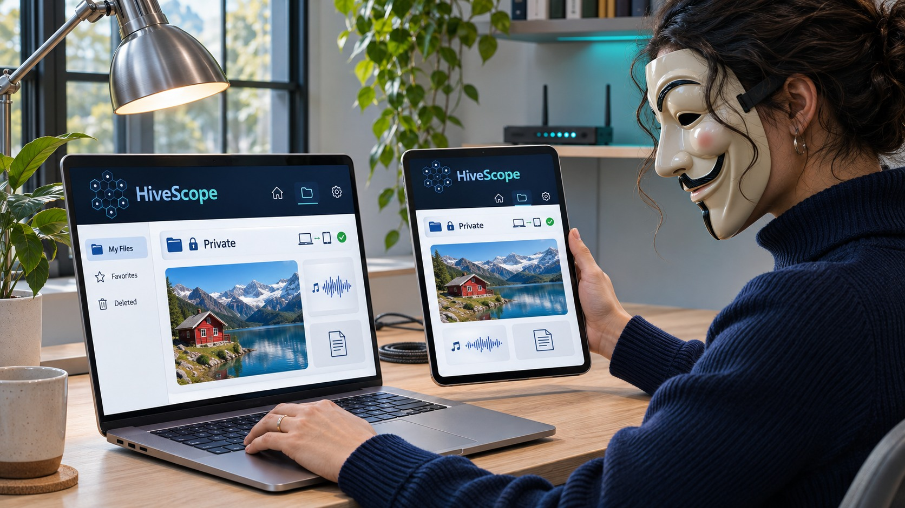
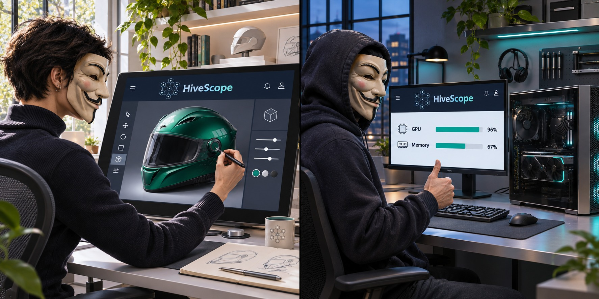
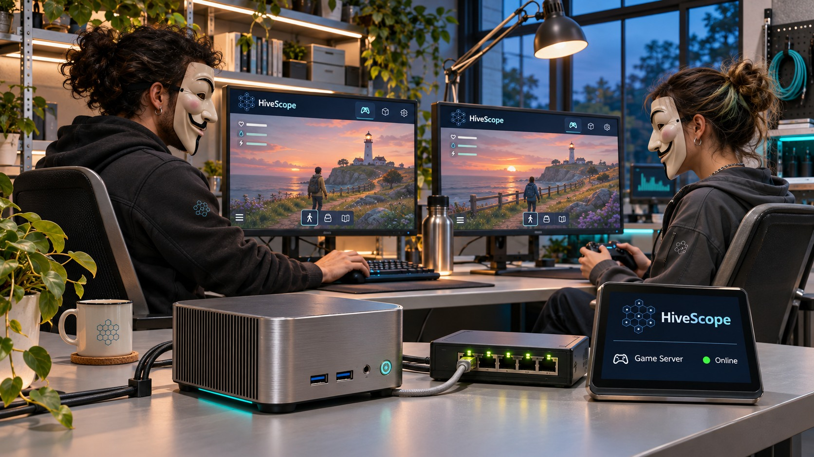

<!-- docs-pair: home; revision: 11 -->

[English](README.md) | Español

# HiveScope

HiveScope es un proyecto de código abierto para compartir almacenamiento y potencia de
cómputo entre personas de todo el mundo. Si necesitas proteger una carpeta, ejecutar
tu propio software o mantener un servidor para tu comunidad, la aplicación buscará
equipos que puedan ayudarte. Si quieres prestar recursos, eliges qué compartes, cuánto
y cuándo. Las máquinas se encargan de coordinarlo.

**La primera prueba de almacenamiento funciona sin red.** Con una muestra de cinco
bytes, las pruebas en Go reproducen los formatos cifrados publicados y recuperan
el contenido original en memoria. El primer prototipo deberá lograrlo en otra
computadora y demostrar que un proveedor rechaza una credencial revocada.
El cómputo privado y el alojamiento de servicios vendrán después.
[Primer prototipo y resultados](docs/es/readiness.md) · [Visión del proyecto](docs/es/vision.md) · [Hoja de ruta](docs/es/roadmap.md)

*Así imaginamos HiveScope. Tú eliges qué dispositivos pueden abrir tus carpetas. Cuando
tu equipo se quede corto para una tarea, podrías pedir capacidad a la comunidad.*

## ¿Para qué podrías usar HiveScope?

### Proteger los archivos que elijas

Guarda copias de carpetas con fotos, documentos, música, código fuente u otros trabajos.
Tú conservas las claves y eliges cuáles de tus dispositivos pueden leer cada carpeta.
La primera prueba recuperará un archivo en otra computadora. La sincronización de
carpetas y las pruebas con celulares y tabletas vendrán después.

### Ejecutar tu propio software

Podrías solicitar CPU y memoria para un entorno privado donde instalar tus herramientas,
compilar un proyecto, renderizar una escena o ejecutar un modelo. Antes de enviar las
claves de sesión, tu dispositivo verificaría el entorno remoto, incluida cualquier GPU
que se utilice. Si la verificación falla o falta un anfitrión compatible, las claves
seguirían en tu equipo. Podrías esperar o cancelar. [Modelo de seguridad](docs/es/security.md)

### Alojar un servicio para tu comunidad

Un grupo de jugadores podría mantener un mundo compartido aprovechando los horarios de
sus voluntarios. Solo un anfitrión aceptaría cambios a la vez. Un relevo compatible
podría continuar desde un guardado verificado. Project Zomboid es un posible ensayo.
El grupo mediría la latencia, las interrupciones y el progreso perdido antes de anunciar
una expectativa de disponibilidad. [Prueba de alojamiento](docs/es/roadmap.md)

## ¿Qué pasa cuando solicitas u ofreces recursos?

Puedes participar solo para solicitar recursos. Eliges lo que necesitas y tu equipo
buscará anfitriones compatibles en directorios comunitarios. Quien presta recursos
configura un perfil una sola vez. Por ejemplo, Luis podría ofrecer 20 GB de disco por
las tardes y reservar su GPU para él. Su computadora comprobaría el horario, el espacio
libre y los compromisos vigentes antes de aceptar una reserva. Ana y Luis podrían usar
el servicio sin conocerse.

Luis podría pausar las nuevas reservas. Las copias existentes seguirían sus acuerdos de
retención. Si faltara capacidad, Ana vería por qué su solicitud está pendiente.
Reintentar la misma solicitud mantendría su estado sin reservar dos veces el espacio.
La participación será voluntaria. El objetivo es acceder a los servicios sin una cuota
obligatoria de alquiler. Los participantes o donantes asumirían los costes del equipo,
la electricidad, la conexión y el tráfico de los relays. [Ofrecer mi equipo](docs/es/resource-offers.md)

## Cómo recuperaría Ana una carpeta privada

### Ana elige qué equipos pueden leer sus archivos

Ana autoriza a su portátil y a su computadora de escritorio a leer `Estudios`, donde
guarda el borrador de su tesis, una foto y una entrevista grabada. Para
`Documentos personales` autoriza solo el portátil. Cada elección se aplica a todos los
archivos de esa carpeta.

### El equipo de Luis guarda la copia cifrada

La computadora de Ana cifra el contenido y los nombres antes de enviar la copia. El
perfil de almacenamiento de Luis admite la transferencia automáticamente. Luis puede
observar su tamaño y el momento en que ocurre. Ana conserva el control de las claves
que abren sus archivos.

### Ana recupera su trabajo en otra computadora

Con el portátil original apagado, Ana usa su contraseña para abrir el paquete de
recuperación que guardó aparte. En la primera prueba prevista, un proveedor accesible
comprueba su credencial de recuperación y el equipo nuevo restaura un archivo de
prueba idéntico byte por byte. Más adelante, cada bloque cifrado se distribuiría entre
tres proveedores para que dos fragmentos válidos puedan reconstruirlo.
[Diseño de recuperación](docs/es/architecture.md) · [Almacenamiento y reparación](docs/es/storage.md)

## Desarrollo y dispositivos

La primera entrega prevista es una herramienta de línea de comandos para computadoras.
Go es la primera opción para el nodo. La referencia para medir memoria, CPU, velocidad
de recuperación y tiempo de respuesta al pausar será un PC de cuatro núcleos y 8 GB
de RAM. Las sesiones confidenciales requerirán ensayos separados con hardware compatible.
La alfa de escritorio se probará en Windows, Linux y macOS e incorporará una
interfaz gráfica tras medir el servicio en segundo plano. Los celulares y tabletas
se evaluarán primero para acceso y recuperación.
[Arquitectura](docs/es/architecture.md) · [Índice de documentación](docs/es/README.md)

## Cómo contribuir

- **Revisa un caso de fallo.** ¿Qué debería ver una persona si un proveedor de almacenamiento
  se desconecta a mitad de la recuperación? Describe el comportamiento esperado con archivos
  de ejemplo. [Proponer un caso](https://github.com/RubioKo/hivescope/issues/new?template=proposal.yml)
- **Diseña una prueba de alojamiento en casa.** Describe el equipo, el horario y el ancho
  de banda que podría prestar una persona, o cómo un grupo comprobaría que puede seguir
  jugando en su mundo después de un relevo. [Abrir una propuesta en Issues](https://github.com/RubioKo/hivescope/issues)
- **Mejora la documentación.** Mantenemos las versiones en inglés y español en paralelo.
  Puedes aclarar una explicación, revisar una traducción o ayudar a incorporar otro idioma.
  [Guía de traducción](docs/es/translations.md)

Crea una rama de trabajo a partir de `development` y dirige tu pull request a
`development`. Los hallazgos de seguridad sensibles cuentan con un canal privado de
reporte. [Guía de contribución](docs/es/contributing.md) · [Informes de seguridad](SECURITY.md) · [Gobernanza](docs/es/governance.md) · [Código de conducta](docs/es/code-of-conduct.md)

Las instrucciones para colaboradores y las herramientas opcionales de asistencia tienen
su propia documentación. [Instrucciones para colaboradores](AGENTS.md) · [Guía opcional de IA y ECC](docs/es/ai-assisted-development.md)

## Licencia y atribución

El material nuevo de HiveScope utiliza la licencia **AGPL-3.0-only**. Los banners
animados, adaptados del diseño original de RubioKo, conservan su licencia **MIT** y su
atribución. [Licencia del proyecto](LICENSE) · [Guía de licencias](docs/es/licensing.md) · [Avisos de terceros](THIRD_PARTY_NOTICES.md)
