<!-- docs-pair: home; revision: 2 -->

English | [Español](README.es.md)

# HiveScope

**What files would you want back if your computer wouldn't start tomorrow?**
Maybe it's your family photos, a thesis, music you recorded or the source code for a project.
HiveScope is an open-source community storage project. We're designing it so you can choose
which folders to protect, keep encrypted copies on computers run by people you trust
and recover your files on a new device. You keep the
keys and choose which of your devices can read each folder. Anyone offering storage chooses
how much space and bandwidth to share and when their computer is available.

**Project status — design and documentation.** The first prototype will run from the command
line on a computer. Windows, Linux and macOS are our target platforms. An installable app
is still ahead. [Vision](docs/en/vision.md) · [Roadmap](docs/en/roadmap.md)

## Ana's files, Luis's spare disk space

[Watch or download the illustrated design example in English (MP4, 30 seconds)](assets/story/hivescope-en.mp4)

1. **Ana chooses a folder.** Her `Studies` folder holds a family photo, the draft of
   her thesis and a recorded interview. She wants to open these files on her laptop and
   desktop. For `Personal documents`, she authorizes only her laptop. Each choice applies
   to every file in that folder. [Ana's files, illustrated](assets/story/hivescope-story.jpg)
2. **Luis offers space.** Luis agrees to host an encrypted copy and sets a disk limit
   and evening transfer hours. Ana's computer encrypts the files and their names before
   sending them. Luis can see the size of a transfer. The keys needed to open the PDF,
   view the photo or play the recording stay with Ana. [What Luis sees](assets/story/encrypted-storage.jpg) · [Security model](docs/en/security.md)
3. **Ana recovers her work.** With her original laptop switched off, Ana unlocks the
   recovery package she kept separately, using its password on a replacement computer.
   While Luis's computer is reachable and their agreement allows reads, she can retrieve
   and decrypt her `Studies` folder. The same photo, draft and interview are there again.
   [The recovery scene](assets/story/recovering-files.jpg)

The first prototype will test recovery with a sample file. Later milestones will test recovery
with one storage provider offline and synchronization between the owner's devices.
[Storage and maintenance](docs/en/storage.md) · [Folder synchronization](docs/en/synchronization.md)

## How you can help today

- **Review a recovery scenario.** If a transfer stops halfway through, what should Ana
  see on the new computer? Describe the expected result and how to check it.
  [Architecture](docs/en/architecture.md) · [Propose a scenario](https://github.com/RubioKo/hivescope/issues/new?template=proposal.yml)
- **Design a home-computer trial.** How much disk space could you spare, at what times
  and with what upload limit? Suggest a test that respects those limits when the computer
  goes to sleep. [Propose a trial](https://github.com/RubioKo/hivescope/issues/new?template=proposal.yml)
- **Improve an explanation or translation.** Pick a passage that would be hard to explain
  to a friend. Suggest clearer wording in English or Spanish, or help introduce another
  language. [Translation guide](docs/en/translations.md)

Questions and proposals are welcome in English and Spanish. Use the private reporting channel
for sensitive security findings. [GitHub Issues](https://github.com/RubioKo/hivescope/issues) ·
[Security reporting](SECURITY.md)

[Contribution guide](docs/en/contributing.md) · [Documentation index](docs/en/README.md) ·
[Governance](docs/en/governance.md) · [Code of conduct](docs/en/code-of-conduct.md) ·
[Contributor instructions](AGENTS.md) · [Optional AI and ECC guidance](docs/en/ai-assisted-development.md)

## License

New project material is licensed under **AGPL-3.0-only**. The adapted animated banners retain
their **MIT** license and attribution. [Project license](LICENSE) ·
[Licensing guide](docs/en/licensing.md) · [Third-party notices](THIRD_PARTY_NOTICES.md)
